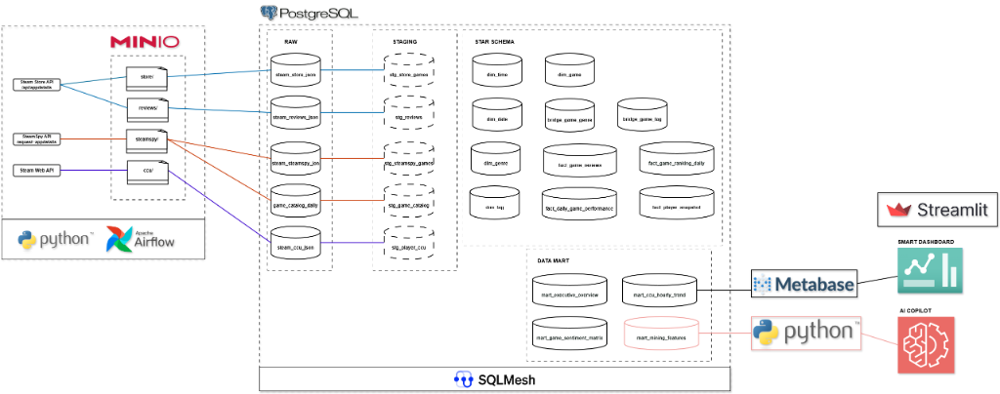

# 🎮 Steam Gaming Market Data Warehouse & Analytics Platform

[](https://www.docker.com/)
[](https://www.postgresql.org/)
[](https://airflow.apache.org/)
[](https://min.io/)
[](https://www.metabase.com/)
[](https://streamlit.io/)

Hệ thống Kho dữ liệu (Data Warehouse) và Khai phá dữ liệu (Data Mining) tự động theo dõi, phân tích thị trường game trên Steam: số người chơi cập nhật mỗi giờ, bảng xếp hạng hằng ngày, tập ~2.000 game cho khai phá dữ liệu hằng tuần.

---

## 🏗️ Kiến trúc Hệ thống & Data Flow (Data Architecture)




---

## 🛠️ Tech Stack

| Tầng chức năng | Công nghệ | Biểu tượng | Mô tả & Cổng kết nối |
|---|---|---|---|
| **Raw Data Lake** | **MinIO S3** |  | Lưu file JSON gốc từ API, chia thư mục theo ngày (`9000` / `9001`) |
| **Data Warehouse** | **PostgreSQL 16** |  | Schema `raw` → `staging` → `dw` (Star Schema) → `marts` (`5433`) |
| **Orchestrator** | **Apache Airflow** |  | Lập lịch thu thập dữ liệu & chạy biến đổi (`8080`) |
| **Transform Engine** | **SQLMesh** |  | Model SQL: làm sạch JSON, Star Schema (SCD Type 2, incremental), data mart, audit |
| **Data Mining** | **Python ML** |  | Apriori (luật kết hợp tag), K-Means, CART, phân loại review (TF-IDF + Logistic Regression), chủ đề phàn nàn (NMF) |
| **BI Dashboard** | **Metabase** |  | Dựng question & dashboard trên schema `marts` (`3000`) |
| **Smart Dashboard & AI Copilot** | **Streamlit** |  | 4 trang song ngữ Việt/Anh: Smart Dashboard (dữ liệu qua Metabase API), Khai phá dữ liệu, Khám phá dữ liệu (Metabase nhúng), Copilot trợ lý khảo sát thị trường (Gemini / DeepSeek V4, tra cứu warehouse bằng user chỉ-đọc) (`8501`) |

---

## 🔄 Pipeline (Airflow DAGs)

| DAG | Lịch (UTC) | Việc |
|---|---|---|
| `steam_daily_catalog_sync` | 00:00 hằng ngày | Chụp 2 bảng xếp hạng chính thức của Steam: top 50 nhiều người chơi + top 50 bán chạy (VN) → `raw.game_catalog_daily` |
| `steam_hourly_ccu_ingestion` | mỗi giờ | CCU của các game trong 2 bảng xếp hạng (~76 game) → MinIO |
| `steam_weekly_metadata_ingestion` | hằng ngày | Store appdetails + SteamSpy của các game trong 2 bảng xếp hạng → MinIO |
| `steam_daily_reviews_ingestion` | hằng ngày | Review của các game trong 2 bảng xếp hạng → MinIO (nghỉ 1,5 s/request theo giới hạn của Steam) |
| `steam_weekly_universe_ingestion` | 01:00 thứ Hai | ~2.000 game nhiều owners nhất (phục vụ Data Mining): Store browse, SteamSpy, CCU, review → MinIO |
| `transformation_staging_to_warehouse` | phút 15 mỗi giờ | Nạp file mới vào `raw` (incremental theo watermark) → `sqlmesh run` |

## 🗄️ Các tầng dữ liệu (PostgreSQL `steam_dwh`)

| Schema | Nội dung | Ai tạo |
|---|---|---|
| `raw` | JSON gốc (1 file = 1 dòng), danh sách game cần thu thập, watermark | Python (`ingestion/`, `transformation/load_raw.py`) |
| `staging` | View tách JSON thành cột, làm sạch | SQLMesh (`sqlmesh/models/staging/`) |
| `dw` | Star Schema: `dim_game` (SCD Type 2), `dim_tag`, `dim_genre`, `dim_date`, `dim_time`, bridge, 5 bảng fact | SQLMesh (`sqlmesh/models/dw/`) |
| `marts` | Bảng phục vụ dashboard và Data Mining (`mart_executive_overview`, `mart_top_sellers`, `mart_mining_features`…) | SQLMesh (`sqlmesh/models/marts/`) |
| `mining` | Kết quả khai phá cho Copilot: `tag_rules` (Apriori), `game_clusters` (K-Means) | Script trong `mining/` |

---

## 📂 Kiến trúc Thư mục (Directory Layout)

```text
.
├── docs/               # Hình ảnh kiến trúc & sơ đồ hệ thống
├── discuss/            # Tài liệu thiết kế & quy hoạch kiến trúc
├── scripts/            # Script khởi tạo database & bảng raw
├── ingestion/          # Gọi API Steam/SteamSpy (curl_cffi), chọn game cần thu thập
├── transformation/     # Nạp file từ MinIO vào schema raw
├── dags/               # Apache Airflow DAGs
├── sqlmesh/            # Project SQLMesh: staging, dw, marts
├── mining/             # 5 kỹ thuật Data Mining (kết quả: schema mining + mining/outputs/)
├── dashboard/          # Streamlit: Smart Dashboard, Khai phá dữ liệu, Copilot (dashboard/copilot/)
├── Dockerfile          # Image Airflow kèm venv riêng cho SQLMesh
├── docker-compose.yml  # File khởi chạy toàn bộ hệ thống
├── .gitignore          # Cấu hình bỏ qua file nhạy cảm & data rác
└── README.md           # Tài liệu hướng dẫn dự án
```

---

## ⚡ Khởi chạy nhanh (Quick Start)

### Yêu cầu tiên quyết
* [Docker Desktop](https://www.docker.com/products/docker-desktop/) & Docker Compose
* Git

### Các bước khởi chạy
```bash
# 1. Clone repository
git clone https://github.com/HakoNguyen/steam-mining.git
cd steam-mining

# 2. Cấu hình: copy .env.example thành .env rồi điền giá trị;
#    tạo sqlmesh/.env gồm POSTGRES_USER, POSTGRES_PASSWORD, POSTGRES_DB

# 3. Khởi chạy 4 dịch vụ (Postgres, MinIO, Airflow, Metabase); image Airflow được build kèm SQLMesh
docker compose up -d --build

# 4. Tạo các bảng raw
docker exec -i steam_postgres_dwh psql -U admin -d steam_dwh < scripts/create_dwh_schema.sql

# 5. Triển khai SQLMesh lần đầu (tạo schema staging, dw, marts)
docker exec -w /opt/airflow/sqlmesh steam_apache_airflow /opt/sqlmesh-venv/bin/sqlmesh --gateway docker plan --auto-apply
```

6. Mở Airflow và bật các DAG cần dùng. Khi vừa được bật, DAG tự chạy lượt gần nhất.

> Một số nhà mạng tại Việt Nam chặn `*.steampowered.com`. Nếu DAG thu thập báo lỗi hàng loạt, bật VPN hoặc Cloudflare WARP.

7. **Kết quả Data Mining (chạy tay, mỗi tuần một lần):** sau khi DAG `steam_weekly_universe_ingestion` chạy xong (sáng thứ Hai), chạy từ thư mục gốc repo. Hai script đầu ghi đè `mining.tag_rules` và `mining.game_clusters` (Copilot dùng); cả 5 ghi chỉ số và mô hình vào `mining/outputs/` cho trang **Khai phá dữ liệu**. App tự đọc kết quả mới, không cần khởi động lại.
```bash
python -m mining.association_rules   # Apriori
python -m mining.kmeans_clustering   # K-Means
python -m mining.cart_tree           # cây quyết định CART
python -m mining.review_classifier   # phân loại review (vài phút)
python -m mining.negative_topics     # chủ đề phàn nàn (NMF)
```

8. **Metabase và Copilot (một lần):**
```bash
# User Postgres chỉ-đọc cho Metabase và Copilot (mật khẩu = COPILOT_DB_PASSWORD trong .env)
docker exec -i steam_postgres_dwh psql -U admin -d steam_dwh -v copilot_password=<mật khẩu> < scripts/create_copilot_role.sql
```
   Trong Metabase (`http://localhost:3000`): thêm database tên **Steam Market DWH** (host `postgres-dwh`, cổng `5432`, user `copilot_ro`), tạo API key ở *Admin settings > Authentication > API keys* rồi điền `METABASE_API_KEY` vào `.env`. Sau đó dựng toàn bộ question và dashboard bằng code:
```bash
python scripts/metabase_dashboard.py
```

9. **Chạy Streamlit** (Python 3.11; Copilot cần `GEMINI_API_KEY` và/hoặc `OPENROUTER_API_KEY` trong `.env`, chọn mô hình ngay trên trang):
```bash
pip install -r requirements.txt
cd dashboard
python -m streamlit run app.py
```

### Các cổng truy cập
* 🗄️ **PostgreSQL:** `localhost:5433`, database `steam_dwh`
* 🪣 **MinIO Console:** `http://localhost:9001` (`admin` / `adminpassword123`)
* ⚙️ **Apache Airflow:** `http://localhost:8080` (`admin` / `admin`)
* 📊 **Metabase BI:** `http://localhost:3000`
* 🤖 **Streamlit (Smart Dashboard, Khai phá dữ liệu, Copilot):** `http://localhost:8501`
